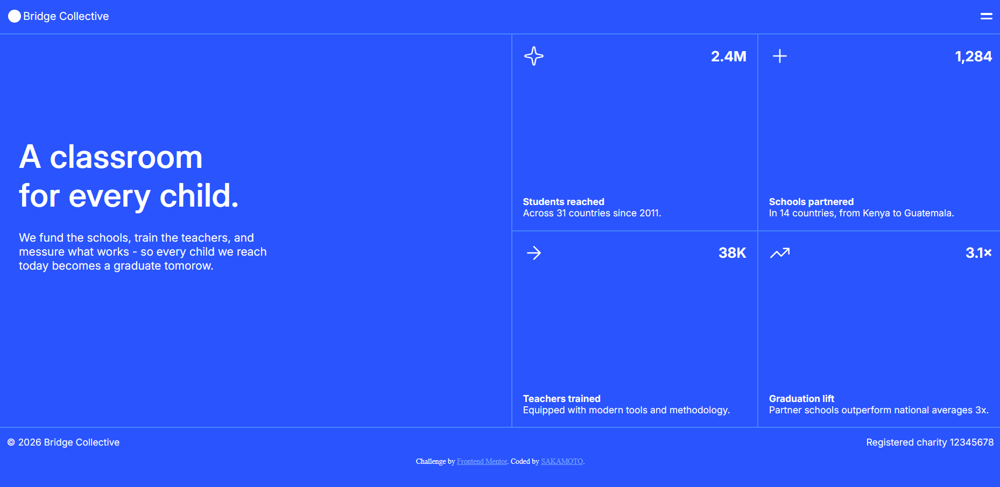
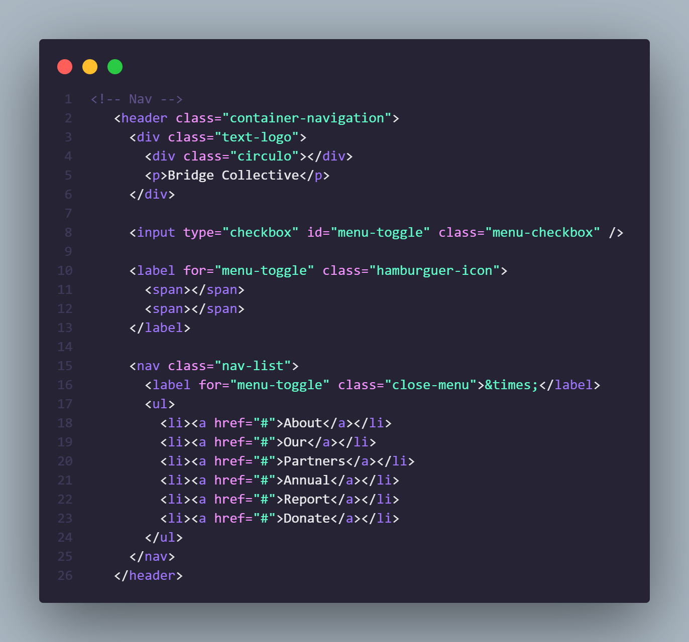

# Minha landing Page 👩🏽‍💻

## Olá, Bem vindo ao meu projeto !! 😋

Participei de um projeto para criar uma landing page com grid do [Frontend Mentor](https://www.frontendmentor.io).

**O desafio era criar uma landing page simples com HTML e CSS.**

## Etapas de criação

Inicie o processo, criando o Menu do meu site, sendo está a parte um pouco mais complicada do projeto. Meu menu não utiliza Java Script para funcionar, tentei fazer o mais simples possível, pois ainda não manjo de Java Script. 😋😅

O restante do código foi feito com bastante facilidade e foi muito divertido fazer todas as etapas de criação.

- Separei meus códigos de css em menu e estilo comum, fiz isso para facilitar o processo de criação e não deixar o css muito grande.
- Usei Media Query para manipular a tela de acordo com os tamanhos dos dispositivos moveis.

O meu código não é mais certo 😅. Mais acho que consegui entregar o prometido 🤔😋

## Deploy do Projeto

Meu projeto está no ar pelo GitHub:

- [GitHub Pages](https://pages.github.com/)

## Adoraria Feedbacks

Eu estou querendo melhorar e adoraria que me digam alguns feedbacks e dicas do que posso melhorar. 👩🏽‍💻👾

**Obrigado por olharem meu Projeto** 🚀
